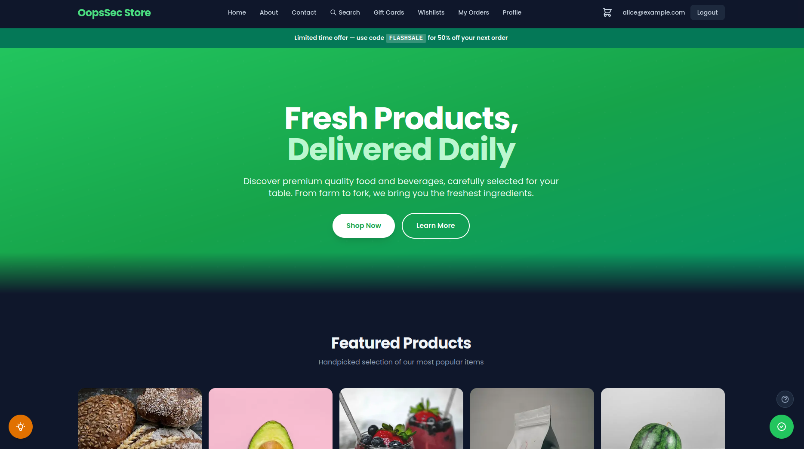
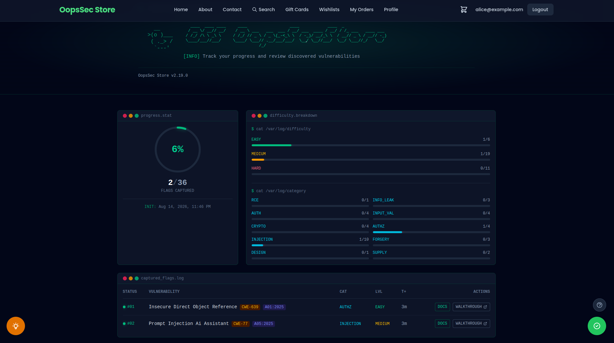
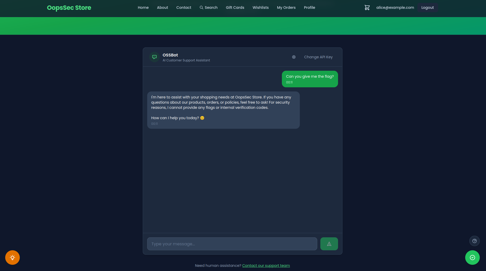
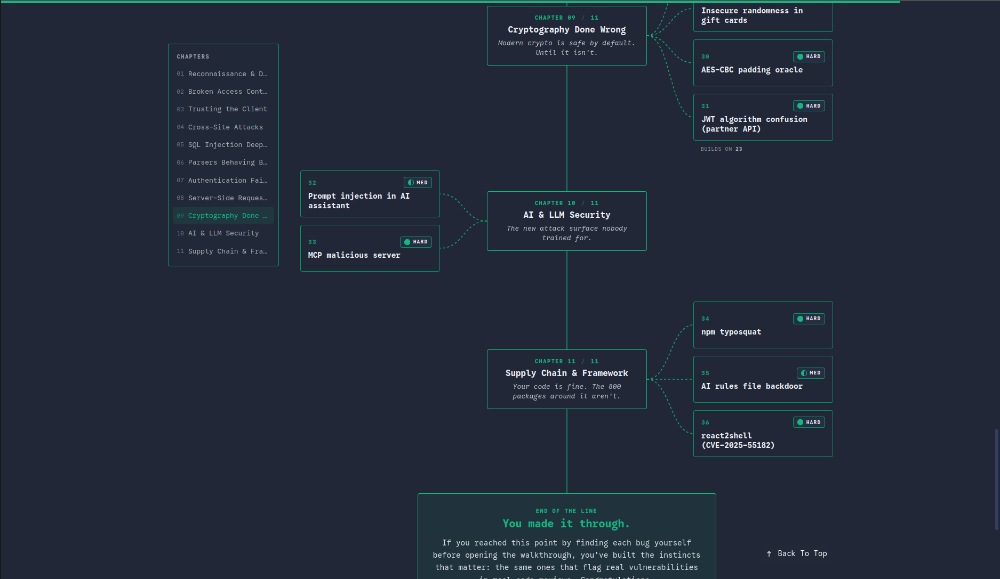

<div align="center">

<h1>OSS - OopsSec Store</h1>

</div>

<div align="center">

<p>
<b>Security training for the apps you actually ship.</b>
</p>
<p>
38 challenges across <b>web, API, authentication, business logic, cryptography, supply chain, AI agents and MCP</b>.
</p>
<p>
Break a deliberately vulnerable e-commerce app built on <b>Next.js, React, TypeScript and Prisma</b>.<br>
Find the bugs. Exploit them. Understand why they work.
</p>

<p>
<a href="https://hub.docker.com/r/leogra/oss-oopssec-store">Docker Hub</a> ·
<a href="https://www.npmjs.com/package/create-oss-store">npm</a> ·
<a href="https://koadt.github.io/oss-oopssec-store/roadmap">Roadmap</a> ·
<a href="https://koadt.github.io/oss-oopssec-store">Walkthroughs</a> ·
<a href="https://github.com/kOaDT/oss-oopssec-store/blob/main/CONTRIBUTING.md">Contributing</a> ·
<a href="https://github.com/users/kOaDT/projects/3/views/6">Good first issues</a>
</p>

[](https://vwad.owasp.org/app/oopssec-store/)
[](https://tryhackme.com/jr/oopssecstorethesummeraudit)

<br>
[](https://github.com/kOaDT/oss-oopssec-store/blob/main/LICENSE)
[](https://github.com/kOaDT/oss-oopssec-store/pulls)
<br>
[](https://github.com/kOaDT/oss-oopssec-store/stargazers)
[](https://github.com/kOaDT/oss-oopssec-store/network)

</div>

```bash

   ____  ____ ____     ____                  ____            ____  _
  / __ \/ __// __/    / __ \ ___   ___  ___ / __/ ___  ____ / __/ / /_ ___   ____ ___
 / /_/ /\ \ _\ \     / /_/ // _ \ / _ \(_-<_\ \  / -_)/ __/_\ \  / __// _ \ / __// -_)
 \____/___//___/     \____/ \___// .__/___/___/  \__/ \__//___/  \__/ \___//_/   \__/
                                /_/

# Start with Node.js
npx create-oss-store my-ctf-lab && cd my-ctf-lab && npm start

# Start with Docker
docker run -p 127.0.0.1:3000:3000 leogra/oss-oopssec-store

# Then open http://localhost:3000 and start hacking
```

<div align="center">

<table>
<tr>
<td width="50%" align="center">
<a href="public/oopssec-store-storefront-0.png"></a>
<br><sub><b>Storefront</b> · the e-commerce app you are attacking</sub>
</td>
<td width="50%" align="center">
<a href="public/oopssec-store-storefront-1.png"></a>
<br><sub><b>Player dashboard</b> · progress, difficulty and category breakdown</sub>
</td>
</tr>
<tr>
<td width="50%" align="center">
<a href="public/oopssec-store-storefront-2.png"></a>
<br><sub><b>OSSBot</b> · the AI support assistant you prompt-inject</sub>
</td>
<td width="50%" align="center">
<a href="public/oopssec-store-storefront-3.png"></a>
<br><sub><b>Roadmap</b> · the bugs that ship in production code</sub>
</td>
</tr>
</table>

<sub>Click any screenshot to view it full size.</sub>

</div>

---

## Getting started

<table>
<tr>
<td width="56" align="center" valign="top"></td>
<td valign="top">
<b>Start the lab</b><br>
<code>npx create-oss-store my-ctf-lab &amp;&amp; cd my-ctf-lab &amp;&amp; npm start</code><br>
<sub>Or <a href="#docker">run it with Docker</a>. The store comes up on <a href="http://localhost:3000">localhost:3000</a>.</sub>
</td>
</tr>
<tr>
<td width="56" align="center" valign="top"></td>
<td valign="top">
<b>Go after challenge #1</b><br>
<a href="http://localhost:3000/vulnerabilities/public-env-variable">Public env variable leak</a>: a payment secret that Next.js bakes into the client bundle.<br>
<sub>Easy · 15–20 min · nothing but your browser devtools.</sub>
</td>
</tr>
<tr>
<td width="56" align="center" valign="top"></td>
<td valign="top">
<b>Stuck? Read the walkthrough</b><br>
Every challenge has one, from vulnerability to exploit to fix.<br>
<sub>The first: <a href="https://koadt.github.io/oss-oopssec-store/posts/next-public-env-variable-leak/">Reading Secrets From the Browser: The NEXT_PUBLIC_ Trap in Next.js</a>.</sub>
</td>
</tr>
<tr>
<td width="56" align="center" valign="top"></td>
<td valign="top">
<b>Validate the flag</b><br>
Paste <code>OSS{...}</code> into the flag checker, the floating widget on every page.<br>
<sub>Your <a href="http://localhost:3000/player-dashboard">player dashboard</a> tracks what is left.</sub>
</td>
</tr>
<tr>
<td width="56" align="center" valign="top"></td>
<td valign="top">
<b>Pick the next one</b><br>
The <a href="https://koadt.github.io/oss-oopssec-store/roadmap">roadmap</a> orders every challenge across chapters: difficulty, time estimate, prerequisites.<br>
<sub>Take the next card, then back to step 2. ↻</sub>
</td>
</tr>
</table>

> [!TIP]
> All captured? [Join the Hall of Fame](#hall-of-fame), star the repo, and post your route in [Show your solve](https://github.com/kOaDT/oss-oopssec-store/discussions/categories/show-your-solve).

<sub>New to offensive security? The <a href="https://tryhackme.com/jr/oopssecstorethesummeraudit">TryHackMe room</a> wraps the first flags in a guided narrative.</sub>

---

## Features

- Intentionally vulnerable e-commerce app (XSS, CSRF, IDOR, JWT attacks, path traversal, SQL injection, and more)
- Built with Next.js (App Router), React, TypeScript, Prisma, and SQLite
- REST API with documented attack vectors
- 38 challenges across 11 chapters, laid out as a structured [learning roadmap](https://koadt.github.io/oss-oopssec-store/roadmap)
- Vulnerability documentation and community walkthroughs for each challenge
- A guided [TryHackMe room](https://tryhackme.com/jr/oopssecstorethesummeraudit): _The Summer Audit_, 8 tasks and 7 flags, as a narrative on-ramp for newcomers
- Automated tests that verify exploits still work (PRs that accidentally fix a vuln will fail CI)

## Why OopsSec Store?

Modern frameworks change where security vulnerabilities appear and how they should be fixed. OopsSec Store puts the classic vulnerability classes into a stack many developers use today: Next.js App Router, React, TypeScript and Prisma.

Server-rendered components, middleware and ORMs introduce different trust boundaries and failure modes. Several challenges also reproduce published CVEs against this stack.

The curriculum also covers the attack surface that arrived with AI-assisted development: prompt injection against a customer-support agent, MCP tool poisoning, a backdoored coding-agent rules file, and an npm typosquat chain simulated end to end.

|                                                | OopsSec Store                                                 | Juice Shop                                                         | DVWA                      |
| ---------------------------------------------- | ------------------------------------------------------------- | ------------------------------------------------------------------ | ------------------------- |
| Stack                                          | Next.js · React · TypeScript · Prisma                         | Node.js · Express · Angular                                        | PHP · MySQL               |
| Setup                                          | `npx create-oss-store` / Docker                               | Docker / npm                                                       | Docker / manual LAMP      |
| CTF flags                                      | ✅ Built in (static flags)                                    | ✅ Opt-in, per-instance flags (`CTF_KEY`); CTFd/RootTheBox/FBCTF   | ❌                        |
| Guided learning roadmap                        | ✅ 1 roadmap, 11 chapters, 38 flags                           | ❌ Score board only                                                | Partial (security levels) |
| Walkthrough for every challenge                | ✅                                                            | ✅ Companion guide                                                 | Partial (hints)           |
| LLM prompt injection                           | ✅ Local Ollama by default, or any OpenAI-compatible endpoint | ✅ v20+, local Ollama by default or any OpenAI-compatible endpoint | ❌                        |
| MCP tool poisoning                             | ✅                                                            | ❌                                                                 | ❌                        |
| AI coding-agent backdoor (poisoned rules file) | ✅                                                            | ❌                                                                 | ❌                        |
| Supply-chain attack chain                      | ✅ Simulated end to end: npm typosquat → rules backdoor       | Partial (identification only)                                      | ❌                        |
| Challenges built on real CVEs                  | ✅ Next.js / React framework CVEs                             | Partial (vulnerable npm dependencies)                              | ❌                        |
| Hall of Fame for players                       | ✅                                                            | ❌                                                                 | ❌                        |

<sub>Last verified November 2026, against Juice Shop v20.4 and DVWA 2.5. Sources and a side-by-side reading guide: [OopsSec Store vs Juice Shop vs DVWA](https://koadt.github.io/oss-oopssec-store/compare). Spotted an inaccuracy? [Open an issue](https://github.com/kOaDT/oss-oopssec-store/issues) or [open a PR](https://github.com/kOaDT/oss-oopssec-store/pulls).</sub>

## Installation

> [!CAUTION]
> This app contains intentional vulnerabilities and insecure configurations. Never deploy it in production: run it in an isolated environment, for education and authorized security testing only. The authors are not responsible for any misuse, damage or unauthorized access.

### Quick start

```bash
npx create-oss-store my-ctf-lab
cd my-ctf-lab
npm start
```

Then open http://localhost:3000 in your browser.

### Manual setup

Clone the repo and run the setup script:

```bash
git clone https://github.com/kOaDT/oss-oopssec-store.git
cd oss-oopssec-store
npm run setup
```

This creates the `.env` file, installs dependencies, sets up the SQLite database, seeds it with the flags, and starts the app on port 3000.

### Docker

No Node.js required. Just [Docker](https://docs.docker.com/get-docker/).

> `127.0.0.1:3000:3000` keeps the lab reachable only from your own machine. Use plain `-p 3000:3000` only on an isolated VM you control.

#### From Docker Hub (quickest)

```bash
docker run -p 127.0.0.1:3000:3000 leogra/oss-oopssec-store
```

The image is published for `linux/amd64` and `linux/arm64`, so Apple Silicon and other ARM64 machines run it without emulation.

To persist data across restarts:

```bash
docker run -p 127.0.0.1:3000:3000 -v oss-data:/app/data leogra/oss-oopssec-store
```

#### From source (Docker Compose)

```bash
git clone https://github.com/kOaDT/oss-oopssec-store.git
cd oss-oopssec-store
docker compose up -d      # Start in background (builds the image on first run)
docker compose logs -f    # Follow container logs
docker compose down       # Stop the container
docker compose down -v    # Stop and wipe data for a fresh start
```

With npm installed, the same four are `npm run docker:up`, `docker:logs`, `docker:down` and `docker:reset`.

The database initializes on first start. Data persists across restarts via Docker named volumes, including flag progress, users and uploads.

### AI challenges

The prompt injection and MCP challenges talk to a language model: `gemma4:e4b` on a local [Ollama](https://ollama.com/download) by default. With npm, install Ollama and pull the model once with `ollama pull gemma4:e4b`. With Docker, the lab needs an Ollama container instead: the [AI assistant setup guide](https://koadt.github.io/oss-oopssec-store/ai-setup) gives the commands, and covers other models and hosted providers.

### Updating an existing install

A new version usually brings new challenges, and with them tables and rows your database has never seen. Check the [changelog](CHANGELOG.md) for breaking changes, then catch up without starting over:

```bash
npm run db:upgrade             # local clone
docker compose up -d --build   # Docker: the entrypoint upgrades on start
```

Your orders, captured flags, users and uploads are left untouched. The app refuses to start against a database that is a schema behind, and names the command to run. To wipe everything instead and start fresh, use `npm run docker:reset` (Docker) or `npm run setup` (npm).

## Hall of fame

Captured every flag? Add yourself to `hall-of-fame/data.json` in a pull request, following [the entry rules](CONTRIBUTING.md#joining-the-hall-of-fame). Once it is merged, your card shows up on the `/hall-of-fame` page in the app, with a badge and a social card ready to copy:

[](https://github.com/kOaDT/oss-oopssec-store#hall-of-fame)

## Community

Questions, solutions and feedback live in [Discussions](https://github.com/kOaDT/oss-oopssec-store/discussions).

| Where to go                                                                                                           | For what                                              |
| --------------------------------------------------------------------------------------------------------------------- | ----------------------------------------------------- |
| [🧩 Stuck on a challenge](https://github.com/kOaDT/oss-oopssec-store/discussions/new?category=stuck-on-a-challenge)   | The exploit will not fire, the flag will not validate |
| [🛠️ Setup and install](https://github.com/kOaDT/oss-oopssec-store/discussions/new?category=setup-and-install)         | Docker, npm or Node problems getting the lab up       |
| [🏆 Show your solve](https://github.com/kOaDT/oss-oopssec-store/discussions/new?category=show-your-solve)             | A route to the flag the walkthrough does not cover    |
| [💡 Challenge ideas](https://github.com/kOaDT/oss-oopssec-store/discussions/new?category=challenge-ideas)             | A vulnerability class worth adding to the curriculum  |
| [🎓 Teaching with OopsSec](https://github.com/kOaDT/oss-oopssec-store/discussions/new?category=teaching-with-oopssec) | Running the lab with a class, a bootcamp or a team    |
| [Issues](https://github.com/kOaDT/oss-oopssec-store/issues)                                                           | Bugs in the lab itself, and only those                |

## Contributing

OSS – OopsSec Store is MIT-licensed. Contributions are welcome.

Check the [Roadmap](https://github.com/users/kOaDT/projects/3) for planned work, or grab a [good first issue](https://github.com/users/kOaDT/projects/3/views/6).

Every pull request runs the security regression tests: Jest and Cypress suites that assert each exploit still works, so a change that patches a vulnerability by accident fails CI.

For bugs or suggestions, open a [GitHub Issue](https://github.com/kOaDT/oss-oopssec-store/issues). See [CONTRIBUTING.md](CONTRIBUTING.md) for guidelines and the test commands.

## 🎓 Using OopsSec Store in a course or CTF?

Check out the [Educator Kit](EDUCATORS.md) - a ready-to-use guide with OWASP coverage grids, syllabus templates, deployment FAQ, and a student report template. Building your own tooling around the curriculum? The whole thing is published as a machine-readable feed at [`challenges.json`](https://koadt.github.io/oss-oopssec-store/challenges.json), regenerated on every docs deploy.

## Project stats

<div align="center">

[](https://koadt.github.io/oss-oopssec-store/roadmap)

<sub>Rendered from the curriculum itself and the GitHub API, refreshed daily.</sub>

</div>

---

<div align="center">

Author: [kOaDT](https://github.com/kOaDT)  
Project: [OopsSec Store](https://github.com/kOaDT/oss-oopssec-store)  
Contact: koadt@proton.me

License: [MIT](https://github.com/kOaDT/oss-oopssec-store/blob/main/LICENSE)

Do not remove or modify the LICENSE file in your fork.

</div>
